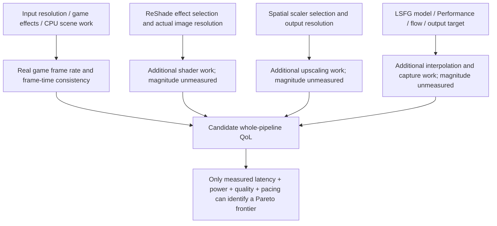

# 16:10 visual-performance frontier: source resolution × LS1 × LSFG × ReShade

**Research date:** 2026-11-02  
**Status:** RESEARCH MODEL / SOURCE ONLY — NO DEVICE BENCHMARKS, NO DEPLOYMENT CLAIM  
**Scope:** general Windows graphics pipeline; reference 2560×1600 output, 240 Hz, 120 nominal native FPS and 237 nominal adaptive output. This is not an individual workstation's readback.  
**Existing research:** [Heaven.gg issue #18](https://github.com/fengie/Heaven.gg/issues/18) (primary-source alternatives, guards and the previous 24-configuration screen).  
**Code:** [resolution-frontier.mjs](../../tools/research/resolution-frontier.mjs) · [tests](../../web/tests/resolution-frontier.test.mjs).

## Decision in one paragraph

**2048×1280 → LS1 → 2560×1600, with LSFG Performance On, is the provisional balanced candidate**, not a mathematically proven best setting. It renders **64.00%** of the output pixels; current 1920×1200 renders **56.25%**. The step from 1920×1200 to 2048×1280 costs **13.78% more source pixels** at equal FPS, not necessarily 13.78% more frame time. The 2240×1400 candidate costs **76.56%** of native pixels and is the image-detail alternative. Only matched scene/hardware measurements can identify the actual Pareto knee. Do not claim higher source-pixel counts linearly imply visible quality or GPU cost.

## Chart A — exact pixel work, not measured GPU compute

At fixed 120 *assumed* game FPS:

| Game resolution | Source pixels | % of 1600p pixels | Source Mpixels/s | Upscale factor |
|---|---:|---:|---:|---:|
| 1600×1000 | 1,600,000 | 39.06% | 192.000 | 1.600× |
| 1792×1120 | 2,007,040 | 49.00% | 240.845 | 1.429× |
| **1920×1200** | **2,304,000** | **56.25%** | **276.480** | **1.333×** |
| **2048×1280** | **2,621,440** | **64.00%** | **314.573** | **1.250×** |
| 2176×1360 | 2,959,360 | 72.25% | 355.123 | 1.176× |
| **2240×1400** | **3,136,000** | **76.56%** | **376.320** | **1.143×** |
| 2304×1440 | 3,317,760 | 81.00% | 398.131 | 1.111× |
| **2560×1600** | **4,096,000** | **100.00%** | **491.520** | **1.000×** |

A 237 FPS *target* on a 2560×1600 output has **970.752 million output pixel positions per second**. This is a count of image positions, NOT GPU shader invocations, the number of generated frames, or a measurement of achieved output.

```text
Relative source pixels per frame (2560×1600 = 100%)
1600×1000    39.1 |████████████████
1792×1120    49.0 |████████████████████
1920×1200    56.3 |███████████████████████
2048×1280    64.0 |██████████████████████████  <-- balanced starting point
2176×1360    72.3 |█████████████████████████████
2240×1400    76.6 |███████████████████████████████
2304×1440    81.0 |████████████████████████████████
2560×1600   100.0 |████████████████████████████████████████
```

**Math:** source pixel fraction = (input width × input height) ÷ (output width × output height); pixels/s = source pixels × assumed native FPS. Scale factor = output width ÷ input width for matched aspect ratios. Ignore shading complexity, overdraw, ray tracing, postprocessing, VRAM bandwidth and CPU overhead when interpreting this chart; they remain unknown.

## Chart B — independent workloads, not an invented stacked utilization chart



The arrows express dependency for a decision, not exact internal rendering-pipeline execution order. Shader passes may overlap or operate at different resolutions depending on game, capture and injection path. Do not add pixel rates as if they were GPU milliseconds.

## Scaler/model alternatives — what is actually known

| Model | Family | Typical reason to select | Comparable actual compute (GPU ms/TFLOPs) |
|---|---|---|---|
| None | No external scaler | Native input already fits output; avoid redundant processing | **Unmeasured** |
| LS1 | External machine-learning-assisted spatial scaler | General 3D upscaling and sharpening | **Unmeasured** |
| LS1 Performance | Cheaper LS1 processing option | Try when the scaler competes with game+LSFG resources | **Unmeasured** |
| FSR (LS spatial) | Spatial upscaler | Alternative external quality/performance balance | **Unmeasured** |
| NIS | Spatial upscaler/sharpener | Prefer only for its specific look | **Unmeasured** |
| SGSR | Spatial upscaler | Candidate low-overhead alternative | **Unmeasured** |
| BCAS | Bicubic + adaptive sharpening | Candidate low-overhead alternative | **Unmeasured** |
| Anime4K | Content-specialized scaling | Primarily anime-style/video content; large models may be costly | **Unmeasured** |
| xBR / integer | Pixel-art algorithms | Retro pixel art rather than general 3D | **Unmeasured** |
| DLSS Super Resolution | Game-integrated temporal ML | Prefer when supported and stable; can use engine motion information | **Unmeasured** |

**No chart of model FLOPs, milliseconds, GPU percentage or comparative visual scores is defensible without same-version, same-input-resolution and same-hardware tests.** The community LS guide [discusses qualitative relative tendencies](https://sageinfinity.github.io/docs/FAQ/scalers), but is **not** a controlled benchmark and should not be promoted to an exact speed ranking. The official THS [LSFG 3.1 release](https://losslessscaling.com/lsfg-3-1/) reports **up to 2× reduction in FG GPU load** with FG Performance On versus Off *depending on configuration*; that does not apply to the LS1 scaler or the total GPU.

NVIDIA [DLSS 4.5](https://www.nvidia.com/en-us/geforce/news/dlss-4-5-super-resolution-available-now/) describes substantially heavier AI models using FP8 on supported RTX GPUs. That report concerns **DLSS Super Resolution inference**, not an apples-to-apples measurement against LS1 or LSFG. Different games, kernels, and precision cannot be converted into universal GPU watts.

## ReShade: treat passes as independent costs

| ReShade group | Purpose | Suggested experimental configuration |
|---|---|---|
| Vibrance / Curves | Color/saturation/contrast | First, keep two inexpensive-looking passes as a *hypothesis*, then measure |
| CAS or another sharpener | Extra edge contrast | Prefer **one sharpening stage**; disable if LS1 already provides enough |
| Bloom/glow | Stylized highlights | Optional: A/B on/off; do not assume free |
| AO, depth effects, RTGI-like presets | Potentially substantial visual changes | Separate study, not baseline; no performance claims without tests |

ReShade is post-processing, not DLSS 5 or AI-generated lighting. It may run on the game's source resolution when injected into the game, but verify the actual rendering/capture path; don't assume its work is always at 1200p. [ReShade official site](https://reshade.me/). Enable HDR-aware filters only for an actual HDR pipeline. Don't stack overlapping anti-aliasing/sharpening effects without an image comparison; additional passes can increase compute and halos.

## Frame generation: optimal base FPS is not always the smallest base

- With **Fixed 2×**, ideal 120 native → 240 output. With **Fixed 4×**, ideal 60 native → 240 output. Real-frame intervals are 8.33 and 16.67 ms respectively. Neither equals measured input latency.
- In **Adaptive**, output targeting is fractional and can resample nearly all displayed frames; **240 minus native FPS is not a reliable observed count of generated displayed frames**. Adaptive itself can cost more than Fixed. [THS Adaptive](https://losslessscaling.com/adaptive-frame-generation/).
- Prefer **the highest repeatable base rate with interpolation active** and enough headroom to avoid saturation; don't maximize output multipliers.
- **LSFG Performance On** is the efficiency-first candidate when FG competes for GPU time; it does **not** necessarily raise base FPS in a hard-capped or CPU-limited game. Use a build containing the [2025-07-14 Performance hotfix](https://losslessscaling.com/performance-mode-hotfix/).
- Capture queue 1 is the documented balanced choice; 2 is a stability candidate for varying source FPS/ratio under 2; 0 minimizes buffering but can worsen performance under high load. [THS queue notes](https://losslessscaling.com/adaptive-frame-generation/).

## Multiobjective decision: no invented all-purpose score

**Maximize** measured game-native FPS and user-rated image quality. **Minimize** measured p99 game frame time, end-to-end latency, GPU watts, and user-rated artifacts. Track CPU frame times, memory/VRAM budget, ReShade and LSFG version, output-frame pacing, noise/temperature and Alt-Tab stability as constraints/context.

`paretoMeasured()` accepts only complete **actual observations** and returns nondominated candidates. If none are supplied, it returns `UNMEASURED`—not a fake center. A setting can be faster but use more power or look less detailed, so a single "best" requires user weights or dominance from measured data. This implementation does not impose subjective numerical weights.

**Blind spots:**

1. A game's visible **1920×1200 menu choice may not match the captured 2560×1600 window**; confirm LS Status and true game render resolution. ReShade or other effects may still execute at full output.
2. 16:10 must be preserved; 1920×1080 is 16:9, not an equivalent option without bars/cropping.
3. Total GPU time is not source-pixel count: frame generation at 1600p and post-processing can dominate after input resolution is reduced.
4. A CPU-bound game may see almost no increase in real FPS when source pixels are reduced.
5. VRAM **allocation** is not VRAM **budget pressure**. Budget exceedance can cause stutter ([Microsoft](https://learn.microsoft.com/en-us/windows/win32/api/dxgi1_4/ns-dxgi1_4-dxgi_query_video_memory_info)).
6. High-power laptop GPUs share thermal and power budgets across CPU, graphics and memory. Hot-run results differ from cold starts.
7. Monitor refresh, actual scaling output, VRR/HDR state and application focus matter; don't force a 237 FPS target on a lower-refresh screen.
8. ReShade/hook compatibility and anti-cheat restrictions require game permission; do not inject into protected games without permission.
9. A bigger AI model is not automatically cheaper or visually better at every source resolution; algorithms and capture paths differ.
10. No measured image quality, power, TFLOPs, actual source FPS or latency was supplied. An exact empirical optimum remains **unknown**.

## How to establish the central point (future authorized measurement; NOT EXECUTED)

1. Freeze one repeatable 16:10 scene, output resolution, camera route, ReShade version, LSFG build, Flow Scale, HDR, VRR, capture API and driver. Separate native game FPS from generated display FPS.
2. Record no FG, no scaling, no ReShade baseline. Then measure the current setup. Avoid additional hooks during baseline.
3. Test three candidate inputs first: **1920×1200**, **2048×1280**, **2240×1400**. Retain 2560×1600 as the reference. Make sure the application truly renders at the requested input size, not merely reports it in menus.
4. On each, run **LS1 Performance On vs Off** with FG Off; then FG On vs Off while using a stable source FPS; then add ReShade effects one at a time. Cross-check interactions only for surviving configurations.
5. Compare at least multiple repeated warm runs per condition using the same scene; collect source FPS, p99 frame time, output cadence, actual latency if measured, GPU/CPU power, memory budget and subjective quality/artifact notes. Alternate trial order.
6. Populate `paretoMeasured()` with complete observations; if it returns multiple nondominated candidates, select based on the desired trade-off rather than invent a benchmark winner.

**Presets pending measurement:** efficiency = 1920×1200 with LS1 Performance On + LSFG Performance On; balanced = **2048×1280** with LS1 and LSFG (Performance On first); higher fidelity = 2240×1400 with LS1 Performance Off if stable. Optional ReShade Vibrance/Curves first, then one sharpener, then Bloom only if its visual payoff is worth measured overhead. All are hypotheses and quality is not quantitatively established.

## Reproducibility / delivery

- Calculations are pure JavaScript (Node 22 ESM) under `tools/research/`. They **do not** inspect/modify computers or games.
- Test source at `web/tests/resolution-frontier.test.mjs` is picked up by the repository's existing `npm run test:web`. **Tests must not be reported passed unless a real CI/test receipt exists.**
- This source-only research artifact does not alter existing HTML, release metadata, game paths, user settings, installer, permissions or deployment.
- Reuse [issue #18](https://github.com/fengie/Heaven.gg/issues/18) for future measurements/decisions; avoid duplicate independent research trackers.
